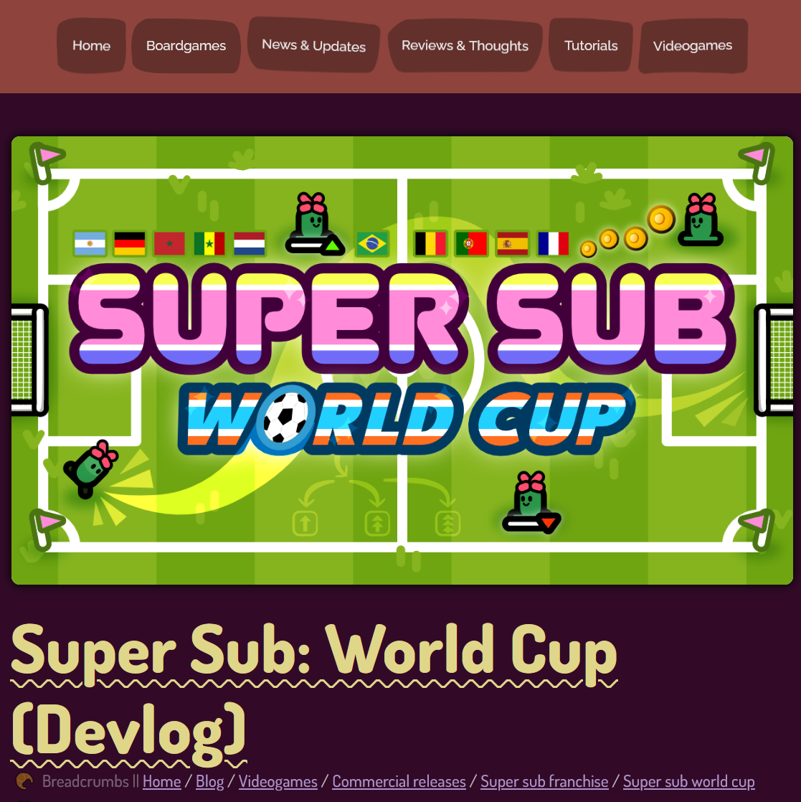

# Pandaqi Blog

This is the full source code / project behind [Pandaqi Blog](https://pandaqi.com/blog/).

## What Is It?

It's the **blog** for the [Pandaqi Game Studio](https://pandaqi.com). This includes ...

* **Reviews** of game engines or game dev tools.
* **Detailed devlogs** for all projects we ever released (the process, earlier versions, problems we faced, lessons learned)
* **Thoughts** about how to develop a good (board/video) game or become a better game developer.
* **Updates on all our work** or big game dev news in the real world
* **Tutorials** on game development, coding, game design.

Despite its simple exterior, it's quite a massive blog. Perhaps because it has existed for so long.

## Project Architecture

It's made using Hugo. This means it's a static website that rebuilds whenever this repository updates.

The actual website is inside `pandaqi-blog`. Everything else is metadata or supportive documents for the project.

Nothing is hidden or changed for this public version. In fact, you'll find many articles planned to release in the future, if you know where to look ;) 

I'm open sourcing all my websites in an effort towards an open world based on sharing and transparency. It's the least I can do.