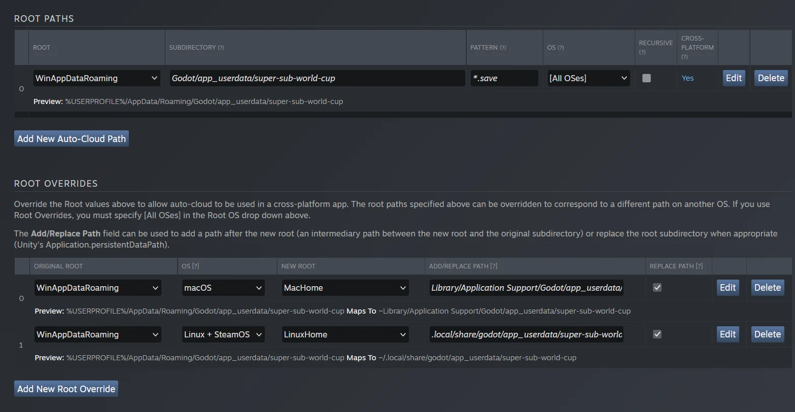

People have been telling me to publish games on Steam for years. Strangers have literally contacted me a few times, saying they played some game of mine or read a devlog, and urging me to stop giving them away for free and start selling. 

I was young and foolish then ;) I responded with something along the lines of "thanks, but I don't wanna". My brain is incapable of staying interested in the same thing for more than a week. That's why I only made tiny free games. Anything bigger was destined to fail. At the same time, such small no-stakes game projects obviously do not lead to income and can't really be sold.

Which brings me to this point in time: _I have no money_. Now, I used to be able to disregard this, thinking I was young and if I just kept working then I'd earn an income in the future. Now I'm slightly older (29) and still have no money, which makes it very hard to ignore it. Even worse, it makes it hard to do _anything_, because you're always worrying about "Is this going to lead to income?" and "Am I even doing the right thing? Maybe I should pursue that OTHER idea instead ..."

Doubt creeps in, your projects become even _smaller_ because you keep jumping around, and at the end of the road you're nowhere.

And so, on my birthday, I had a check-in with myself---surprised to learn I was _almost thirty!_---and realized I simply had to change my mind-set. I had to blatantly pursue _money_ with my creative projects. Get capitalistic. All business now.

At this point, I have ~15 years of experience programming and making (board/video) games. It's on and off. Most of it was hobbyist or free. But it's still a lot of experience.

I _felt_ as if I should be able to make a Steam game, sell it for a price above 5 euros, and earn somewhat sustainable income from it. It felt like I'd grown enough as a developer/creator to be _able_ to do this now.

And so I went for it.

_This article details the entire process of getting [my first game on Steam](https://store.steampowered.com/app/4744020/Super_Sub_World_Cup/), from start to finish, knowing absolutely nothing when I started. Hopefully it's interesting to read, both my mistakes and my good choices. At the same time, there is simply no alternative to just making your own mistakes and learning how all this works yourself (in practice)._

_Also, I wrote a [separate devlog about the game's creation](https://pandaqi.com/blog/videogames/commercial-releases/super-sub-franchise/super-sub-world-cup/). I only mention the major steps I took in the timeline when it makes sense for the story, but without any further details or explanation. It's not about the game in this article, it's about the journey to getting "the product" on Steam!_

## Getting An Account

I wanted to do this quickly, because the internet kept warning me that it would take 2--7 business days for them to check new accounts. And maybe even much longer if _something_ went wrong with your ID, or Tax Information, or any part of the process.

Color me surprised when I submitted my application one evening and was accepted the next morning!

Granted, I have experience with this. I've had my own business ("sole proprietorship") for 10 years now. I know the tax documents to file, I know the treaty that the Netherlands has with the United States that reduces the tax rate to 0%, and so forth. When they asked for a photo of my ID and a selfie, I sent them clean high-resolution PDFs.

Then again, maybe I was just lucky and the timing worked out. Once I was accepted, I could access the full dashboard, get more information on events coming up, and so forth. 

{}
I had half a mind to submit my first game to the upcoming "Ocean"-themed event. But without an account, I could not view any details about this event and did not know if the idea I had would even qualify! Once I had an account, I read the requirements, saw that my idea would only _half_ fit the event and picked something else.
{}

Below are my notes on the process.

* You have to **pay the Steam Direct Fee ($100)** (once) to make this account. This fee gives you one **app credit**. You _don't_ have to decide on anything yet at this stage, though! You can simply use that credit at some later stage, once you've decided the project for which you want to use it.
* Until you submit tax information for review, your progress is **not saved**. Yes, the instructions say you can take all the time you need, which is true, but you can't just close the window and continue tomorrow, because the data you entered so far will be gone.
* Once your basic information is accepted, the next step of the process opens up. You have to send a scan of your ID/Passport (front+back), and a selfie of you holding it, to a DropBox folder. This felt a bit clunky when I read it, but the process just ... worked.
* Your **account name can never be changed.** This, however, is a name that nobody else will ever get to see. It's supposed to be a secret, unique identifier for your account. Your **public name** can be changed at any time; I obviously changed it to _Pandaqi_, the game developer nickname I've been using for 15 years.

## What to make?

Now I had to actually make the game. As stated earlier, I _wanted_ to make the release coincide with a festival or themed event. It just makes sense: you get a clear deadline + extra marketing boost at the time. 

It is, however, always my luck that all the great events for which I had great ideas happened months ago, and the upcoming events did not align with my work at all. That same luck of mine made me just _four days_ too late to register for the upcoming Next Fest.

I had to let go of that idea. Instead, I turned towards festivals in the real world. More specifically: the football/soccer world cup coming up.

Since I decided to publish something on Steam (weeks ago now), I'd been keeping a list of game ideas that would fit. Game ideas that were small and doable, but also proven to sell quite well. That list already had some 50 ideas at this point. 

I sorted it by quality and feasability of the idea to get a Top 5. 

{}
By that I usually mean that I take the ideas with the _lowest risk_, which still have _something unique_ to make it worth making. Ideas that have too many "question marks" remaining, for example, might be amazing ... but it could take months to sort through those question marks and figure out answers. That's too risky for a first game. Similarly, some ideas are so simplistic that they contain no risk, but also no reason to make them as they're not adding anything new.
{}

One of the ideas in that Top 5 was a football-inspired kind-of-incremental game. Thus it was decided: I would make that game and release it during the world cup.

This gave me roughly **1.5 month to make and publish that game**.

Yes, that's short. It's a stupid timeframe. But FIFA was unwilling to move the starting data of the world cup for me. Strange.

## The First Week (May 04-May 10)

The first few days were spent prototyping. I threw sand against the wall to see what stuck. I tried to find the _simplest, most fun_ core game loop for this idea. Usually I would take more time for this. I still wasn't sure on a lot of things, and not sold entirely on my core loop, but I had to keep going.

The latter half of that week was spent making a "vertical slice" of that idea. Adding graphics, sounds, menus, everything _around_ the game that's needed to make a playable demo or get screenshots. Because time was so short, I had to get that marketing material / demo out very early. Thus I opted to make the first "match" of the game feel as polished and finished as possible---while all later content in the game had to wait.

I (mostly) achieved this objective! At this point, the game was fully playable and looking/feeling quite good. It's just that you couldn't get further than the first match and the first bunch of upgrades. But hey, we have one more month for that.

Now you might see why I mentioned my game dev experience and hyperactivity at the start. The "benefit" of a hyperactive brain is that you're like a machine generating ideas and creative stuff, and when you enter a hyperfocus, you can get a _lot_ of stuff done. The "downside" of such a brain is that you're always at risk of burning yourself out, or losing that focus because you had a new shiny idea.

By Saturday, I was feeling a bit exhausted by all the work I'd done. I knew (from experience) that if I pushed through and kept working that both the game and my health would just suffer. I'd just get so tired that I make mistake after mistake and start to hate the project.

Thus I decided to take Sunday off. I only asked someone to playtest the game and made a loose first draft of what marketing would look like. Because I _did_ have to start putting something out into the world ...

{}
At this point, you always look at the pile of work ahead of you and feel like "you can't do it". It's too much. Too little time. But I've learned not to give in to such thoughts or feelings. It's just a weird psychological thing humans have. We always OVERESTIMATE what we can do in a short amount of time (e.g. a day), but severely UNDERESTIMATE what we can do with more time (e.g. a week). I knew that the game's entire content could be done in a week---as long as I kept doing a little bit each day. Kept "crawling forward", they often say.
{}

## The Second Week (May 11-May 17)

Monday, 2nd week of development, and it's exactly 1 month until the world cup starts. 

I learned a few more things about Steam.

* I checked the **upcoming games** (SteamDB) and was happy to see that none of them had anything to do with football or the world cup. I was afraid that many others might try and hook into this event like I did, but it didn't seem like it. At the same time, this could mean there is just no audience for it ...
* I checked what other games were doing and what "experts" were saying. Many of them used Itch.io as a sort of "viability test". They recommended throwing your demo on there absolutely as early as possible, not to attract players, but **to _validate_ if it interests anyone at all**. They also recommended getting your Steam page up as early as possible so you can start linking to it and gathering wishlists.
* Steam has a rule that you have to **wait 30 days after making an account** to publish your first game. But you only have to **wait 2 weeks after submitting a game** before it's allowed to _launch_. I didn't want to take any chances with this, though. If they find something wrong during review, it can easily add another week or two.

All these lessons showed me that I should start showing and submitting the game _now_. Even if it's very much unfinished. (Again, I _know_ the timeframe here is stupid and dumb, please take more time for your first Steam release. Get more sleep. Get your page up and running at least 3 months before release.)

On Tuesday, I published a demo on Itch. I clearly labeled it as a demo/sneakpeek. Not finished, but looking for feedback and looking to release on Steam for the World Cup.

There was a fragile balance here. I had to make the game look as if it could be published in a month, while managing player expectations about what the game was at the moment. 

{}
Honestly, _player expectations_ is almost 100% of the process of marketing. You can have the best game in the world, but if people expected _more_, they'll leave negative reviews anyway.
{}

For example, at this point, **all the upgrades were already in the game**. That's a lot of content! That's where a lot of dev time went! But you can't really _see_ that. Nobody will get there if the first match they play is annoying and they quit.

The Itch demo release was ... mediocre. Because I was not able to create a trailer in time or link to a Steam page yet. Purely from screenshots and some text, a handful of people visited the page and downloaded, but none gave any feedback. This taught me to really launch demos and pages at once the next time, _with_ a trailer.

Taking a few lessons learned from Itch, I launched the Steam page, but without a demo yet. Why? Because **uploading on Itch is way easier than on Steam**, which has way more steps and details you need to know. It's also subject to quite stringent review. I just had to find time to sit down for it and go through the steps.

Most of this week was spent on ...

* Adding sound + some extra visual polish.
* Supporting possible late-game mechanics (such as fouling, referee, injuries)
* ... which were needed to support the second half of the bracket (the matches until the World Cup Final)
* Changing the cost of upgrades and the order in which they're introduced, due to feedback from others playing the game. (At this point the upgrades had only just been implemented, so their value and place in the tree were an "educated guess". I knew the next few weeks would be about finetuning/balancing that.)

I'll give a quick example and then continue. At first I only introduced different ball types quite late. But I noticed that adding a ball that scores double is such an easy way to get players thinking differently and make the game more interesting. ("Should I try to shoot this more valuable ball, even if it's further away from the goal? Is this upgrade worth it in the first place?") It just had to be introduced near the start.

This is where the issues with moving so fast become visible. I had to shuffle around massive parts of the codebase because I initially wrote them thinking mechanic X was the core of the game, but after working on it for more days I realized mechanic Y should actually take center stage. Preferably you catch these things while prototyping. I mean, I can write flexible and reusable code, but there's always a limit to flexibility :p

## The Third Week (May 18-May 24)

This is that middle spot where the game hasn't _fully_ come together yet, but the end point is somewhat in sight. It's equal parts disheartening and hopeful. The muddy middle, as writers sometimes call it.

* Creating, tweaking, balancing the entire bracket (from first match to final). I needed to be able to do a _full playthrough_ of the entire game at the end of this week, without bugs or missing pieces.
* All sorts of tiny bug fixes, tiny improvements to feedback, etcetera.
* Realizing I'm never going to use a few mechanics I half-implemented, so I discarded them and scrapped them off the to-do list entirely. Let's not waste any more breath on them. 
  * (Example: _height_. I had initial support for balls going off the ground, shooting OVER other players, etcetera. But I dropped it because it added too many complications, too little fun, and the game was already full.)
* Finishing (and polishing) the structure _around_ the game (picking a mode, settings, etc).
* **Integrating the game with Steam.**

I initially worked on the game every day, but by now I started switching projects again. It was "done enough" that I knew I would meet that deadline (unless some crazy things happened, you never know). At the same time, my well of energy and inspiration was dry after so much work on the same thing, so I decided to recharge by ... starting five other prototypes that might become Steam games. 

Game developers are a weird breed.

Anyway, let's talk about that final bullet point on the list. **Integrating with Steam.** It means I add their SDK to the game, I add Achievements, I am able to store/read some data, and to get the page set up with a demo.

It was a _lot_ of stuff to learn and figure out. I'll talk about all the steps in more detail, to help _you_ and also help my future self when I use this as a reference ;)

## Store Admin

### Step 1: Use my App Credit

This one is quite easy. On your dashboard, to the right, you get a button (if you have an app credit already) to turn the credit into an actual project. It only asks for the **type** (Game/Software) and the **name**. You can **change your name up until the point your store page is officially live**.

After a few seconds it should have created your app.

When listing your apps, it shows _two links_ behind each one: **Steamworks Admin** and **Store Admin**.

The first one is for the behind the scenes stuff, such as the actual builds to upload and technical details. The second one is for the store page and public presence.

For now, let's focus on the second. 

Once clicked you get a huge number of tabs. A good number of them are irrelevant for now, so I'll focus on just the important parts.

### Step 2: Filling In Details ("Basic Info")

Everything here is _required_, unless I say otherwise.

* Add the **name of the developer and publisher**.
* Add **links to your website and support** (optional). I added YouTube and Bluesky because, well, that's all I had.
* Add **information about supported platforms/hardware**. I simply looked at other games that are as simple/small as mine and copied theirs. (For Windows I could fill in the specs of my own broken 15-year-old laptop. I hardly think anyone out there has a worse machine than that.)
  * This is somewhat optional as in that you have a lot of freedom in what you put down and it can't be checked. Just make sure you put down something reasonable and true.
* Add the **release date**. You have to pick a date **at least 2 weeks into the future**. You can change this date at any time ... _until_ you've entered that 2 week period. Then Steam considers the date set in stone and that's that.
  * You can pick a _separate_ release date to show to players. A "public" release date that can be more vague or specific than the one you're using behind the scenes.
* Add the **supported languages**. I had "support" for localization, but had not actually localized yet (because that's something you'd rather do at the end when all text in the game is known and set in stone). So I initially just picked English, but there's a list of some 30 languages that Steam supports fully.
* Add the **number of players**. I could just pick "single player" and that's it. If you pick "multiplayer" you can specify what exactly that means (online? offline? co-op? etc)
* Add the **supported features**. This is part of that list of details you see on a game's steam page below the top banner. I enabled only two (Steam Cloud and Achievements).
* Pick your **genre**. You can pick as many genres as you like, but **two** is recommended, and you have to pick a "primary" (most important) one.

Then you get three different "wizards". They represent a slightly more complex/step-by-step process to set a certain type of data.

* The **tags** wizard is very useful. It lets you pick tags, genre, theme, style, etcetera. It highlights common combinations and shows you what games are "most like yours" (looking at just your tags). At the same time, the list of options was somewhat sparse and I realized my idea did not fit a lot of it. That was somewhat frustrating, but also an opportunity to copy those tags and pick my next idea with those in mind.
* The **controller support** wizard asks if controllers are supported and how exactly. It gives a clear list about what "support" means: UI completely traversable, key/button hints displayed, etcetera. I had to pick "no support" for now because at the time of my demo, I did not have gamepad support!
* The **accessibility** wizard has a long list of possible features of your game that allows more people (possibly with handicaps) to play. Some of these can be a bit vague. ("Game does not rely on color". I mean, there's nothing in my game that is _solely_ communicated with color, but if you were to, say, play it in grayscale then it would surely make it harder to play. And I think that's true for almost all games. So ... can I tick this checkbox?)

Then you have some questions about 3rd-party links and legal/copyright notices, which is optional. It's not relevant for me or most indie devs. (Sure, you can put down that you have copyright for your game, but that is completely meaningless and just for show. You have copyright by default if you make something. You _don't_ have a trademark or anything unless you apply for it.)

And finally you have to provide **support contact info**.

### Step 3: Description

Here you write your **long description** (on the actual page) and **short description** (shown below game image at top and other marketing spots on Steam).

I'm a prolific writer too. I can write good clean copy all day, but that's ... not the goal, is it? The goal is to communicate the game and get people excited enough to try/purchase it. I've _very rarely_ seen people actually read text and it having any sort of positive impact.

So I just wrote something that communicated the basics ("who is it for and what do you do?") and made some on-theme jokes to stand out more. I think that's all you need to do, honestly. No wall of text, no further details, no introductory story about who you (the developer) are. Let people immediately know what the game is and if it's for them, exit before the description gets dry and repetitive.

Then I told myself that I had to **add images/GIFs**. There's a space next to the text editor to upload any images you want. Once uploaded, you can insert them into the long description at any place.

Below these required descriptions are some optional fields that don't make sense until you release the game (or have a _very_ popular game): reviews, awards, and special announcements. I left them empty for now.

### Step 4: Graphical Assets

I kind of like the way they do this and I also kind of don't.

Steam asks you to make **a lot of assets**. Different resolutions, different formats, different types, used in different places throughout their app.

That's why this tab is broken into 4 sub-tabs. That's when you know they mean business.

Each tab gives a pretty clear explanation of what they expect, what to look out for, etcetera. I could just create a new file in my illustration software, create artboards with all the right sizes, and get to work. 

Because at the top of the page is a _single_ upload field. You don't get one field attached to each image type they want---there's one field where you can drop _everything_. Steam will figure out (based on size) what it's supposed to be. Once you accept that---just check if they're right---the images are uploaded and put in the right place.

Here are some lessons I've learned and things to look out for.

* If you intend to localize your Steam page, add `_language` to the end of your images. (So, `main_capsule_english.png`) Steam will automatically group them by language. Even if you _don't_ intend to do this, it can never hurt to add the language tag anyway. Who knows what the future holds.
* Most of the assets are just the same thing in a slightly different format: your main logo, against your main background, that's it. But a few of the assets require some extra effort.
  * The **library hero** should _not_ contain any text but just be a nice general background banner image. It's also a _massive_ image so make sure it's high-resolution.
  * Because the **library logo** is placed on top of it! That's why this logo needs a **transparent background** (and just your logo, absolutely nothing else)
  * Using their placement tool you can decide where the logo is placed and check what that looks like in someone's Steam library.
* You must **provide at least 5 screenshots**, which should **actually be screenshots**. No menus, but also no concept art, or paintings done outside the game, or screenshots with the UI hidden. Steam wants an _actual picture of your actual game_. Also, they must be high-resolution (at least 1080p), but that usually shouldn't be an issue.

I rather quickly discovered a good way to optimize this batch of work: I **split my capsule artwork into separate layers/PNGs**. One layer for the football pitch, one layer for the logo, etcetera. I ended up with 6 layers that, when placed in the right order, simply look exactly like the capsule again.

So what's the point? Now I can import these images and easily move them around, enable/disable some of them, resize one or two, and get all those variations that Steam wants. Because the same 6 layers are imported and reused everywhere, my computer won't start lagging or protesting by the time we get to the 10th image :p Additionally, if I want to change anything---say, the color of the pitch---I only need to update that _one_ pitch layer that's linked everywhere, and now all my art assets are updated automatically.

I heard a lot of complaints about this step. People saying that Steam wants "too many different assets" and that it "took a lot of time and effort". That's why I was dreading this step a bit. But having experienced it, I don't agree with any of that. All in all it took me 2 hours to get all these images done, uploaded, accepted on the store page. (That said, I have a LOT of experience in lay-out design, illustration, image formats, etcetera. And my game has a relatively simple design/art style.)

### Step 5: What I'm Ignoring

There are a few steps I ignored on my first go: **Ratings, Early Access, Trailers, Special Settings, Localization**. I imagine this will be the same for most (new) indie devs.

A _rating_ is only relevant for big games and when you _actually have the documents for an official rating in many countries_.

Similarly, Early Access only applies to games with a long development time, and ones for which it _makes sense_ to release early. (A puzzle game, for example, has no use being early access because each puzzle can only be solved once and that's probably not changing anymore in later versions.)

The Trailer **is important**, but I didn't have one yet. The game needs to be in a good-enough state, and you need a lot of footage and a computer good enough to edit that, and I just didn't have that in time. I added a trailer shortly after the page had been published for the first time though.

The Special Settings are for Bundles, DLCS, Demo, Playtesting, etcetera. You can't do anything here yet until your page has passed its first review and has gone live.

Finally, Localization is important but not crucial. Essentially, Steam allows you to **download all your current text as a text file**. You can then open that text file, and for each bit of text _add the translations_. Once done, upload that text file back and Steam will recognize the translations and save them in the right places. It's a pretty nice workflow. It also works best if your current text is all filled in and done, so you don't need to make any changes anymore, so I left it for now.

### Step 6: How Do We Publish?

Confusingly, the **Publish** tab here does not allow you to publish the page. It merely gives a list of all previous published versions. (Which is empty at this time, of course, because it has not gone live yet.)

Instead, you must **return to your app's landing page**. (You can get there in a myriad of ways. It's slightly confusing. You can, for example, go to _Dashboard_, scroll down to the game and press _View Checklist_.)

At the top, it will show that you've now **completed the Store Presence checklist**. This gives you a button to **mark the page for review**.

Steam will take a few days to review it. Once accepted, _that's_ when you can publish and it goes live. (Later updates, as long as they're not too big, do not need to go through review anymore.)

## Steamworks Admin

Now that the page was setup, I switched to the other side: Steamworks Admin. It was time to actually put the game on there and integrate its features with Steam.

### Step 1: Preparing To Upload A Build

The way that Steam handles this is baffling to me. I mean, it works _fine_, and there are some advantages to it. But they could've easily supported some alternative and simpler ways to do the simplest, most important, crucial thing that every game needs: **uploading the game to the system**. Instead, it takes way more steps and specific knowledge than you'd want.

Here it goes.

* Every app on Steam is a **package**. 
* Every individual "bundle of files" that a user can download is its own **depot**. (Different operating systems are different depots, maybe you have a separate soundtrack, etcetera.)
* Every **build** of your game has to go into specific _depots_. (One build command can push it to multiple depots. Again, perhaps because you want to push to all operating systems at once.)
* Additionally, every build is put onto a certain **branch**. You have a single **default** branch by default, which is the one that's public and for players. But you can create more "beta branches" if you want to test different builds behind the scenes.

As such, what major steps must be taken to upload a build?

* **Configure depots in Steamworks**. Go to the `Steamworks` > `SteamPipe` > `Depots`. By default, a single depot exists, configured for Windows. I added two more for Mac and Linux, for example.
* **Attach the depots to the app package**. Go to `App Admin` > `Associated Packages` > Click the one > Add the depots you just created under **Depots Included**. (This is _very hard to find_ but _very important_.)
* Now **publish these changes**. Go to `Publish` > `Prepare for Publishing` > `Confirm`. Any unpublished changes are not visible/final to the outside world yet! So if you don't publish, you still can't upload to these depots. (As the page explains, as long as your app isn't released yet, publishing does _not_ mean any gamers already get to see it. It's still "private".)
* Now we can use **Steamworks SDK** (either command line or their GUI) to actually upload our builds!

### Step 2: Uploading A Build

Within Steamworks SDK, you can find **SteamPipeGUI** inside `tools`. This is just an app you can start by double-clicking, which provides an interface for uploading builds. (The alternative is to use the command line and typing the exact upload commands yourself. It gives more control and I will experiment with it later, but for now the GUI will do.)

Once opened, you have to tell it _what_ to build.

* Put your game builds inside `ContentBuilder` > `Content`. Each different "depot" should be inside its own folder. All files within that folder will simply be uploaded to Steam and put into that depot. (So _don't_ add any junk or files you don't want to be publicly downloadable.)
* Now tell the GUI the path to this `ContentBuilder` (bottom of screen).
* Add the unique `App ID` at the top. (Beware: DLCs, demos, and other variants on your game usually have their own ID. So if you want to upload builds for a _demo_, you have to put the _demo package ID_ there.)
* Add all the depots you just created (check if their number is correct). Add the path to the right folder of files that should go into it.
* Once done, click `Generate VDFs`. These are "configuration files" that actually tell Steam where to look and what to do. If you didn't use the GUI, you'd have to write those files yourself. The GUI is just a way to achieve the same thing in a slightly easier way.
* Finally, fill in the credentials for your Steamworks account at the bottom.

Now you should be able to press **Upload**. It opens the command line, reads your VDF files, logs in, and starts uploading.

It will tell you if something went wrong. For example, I used the wrong password the first time, and then it just aborts and tells you to check your credentials again.

The second time it failed because it could not find my Mac depot. That's because I hadn't _published_ those changes yet.

The third time it worked like a charm!

Once done, we go to **SteamPipe > Builds** and should see that our new build has uploaded. Set the **branch** to **default** to actually make it appear on that branch, preview changes, then publish if you're content with it.

_Now_ our build has been uploaded into the right place and set up for delivery.

### Step 2: Setting Launch Options

Go to `Installation` > `General Installation`. There you _must_ set the **Launch Options**. 

Basically, it means you tell Steam _what file to run_ (when starting the game on a certain OS), but also _what other arguments/data to give it_. Complex games might require sending some command line arguments, launching a different launcher first, etcetera. Most games---like mine, like indie games---should just point at the right executable here.

In my case, I need 3 different launch options because I support 3 operating systems. Fortunately my game does nothing fancy---it just needs to launch---so my options here are as simple as can be.

* I create new launch options until I have three of them.
* For each one, I write the name of the executable (including extension, nothing else because it's not inside a subfolder or anything),
* And I set the correct OS for it.

That's all I needed to do to check off this item on the long to-do list. More complex games with different launch patterns need to look more closely to what's happening here.

### Step 3: Enabling Steam Cloud

Go to `Application` > `Steam Cloud`. 

What is Steam Cloud? It's free storage space you get for **save files** and other perminant data for players. It means you have a backup, but it also means that players could switch to different devices and play from the same saves. It's a relatively easy feature to support with possibly huge benefits, which is why I wanted to look at it.

Essentially, it works by **syncing a directory**. You tell Steam the directory/files that it needs to "store in the cloud". It will automatically upload/download them and put them in the right place, so that players can access the same save files in different places.

How does that work? It depends on your game engine (and maybe your game). As such, I'll show a screenshot for my setup for the Godot Game Engine.

First, you need to set the **byte quota per user** (how much storage each user gets) and **number of files per user**. My game only generates a single small save file, so I checked its size on a large game, then doubled that.

Then: 

Basically I tell Steam where Godot puts my save files. (And to _only_ look for `*.save` files, not any of the other junk in that folder.)

Then I tell it how to "convert" that to the other operating systems.

### Step 4: Achievements

These can be found under **Stats & Achievements**. _Statistics_ and _Achievements_ are very similar and tightly coupled, but they are still different things. The documentation is horrible on this---I had to figure it out from Reddit threads and trying stuff myself.

Here's what I've learned.

* **Statistics** simply allow you to track and store someone's progress (numbers; integers or floats).
* **Achievements** are milestones within the game that someone has either achieved or not (boolean; yes/no).

You can set achievements manually within your game. For example, if you have to check something really complicated ("you discovered the Mysterious Hidden Room in the Tarabunga Forest!"). This requires custom code, specific to your game, so you have to write the check yourself and tell Steam about it.

But many achievements are simpler and _numeric_. For example, "Kill 100 enemies" or "Reach level 5". That's where statistics come in! When creating a new achievement, you can **connect it to a statistic** (that you already defined earlier). If that number reaches the right threshold, Steam automatically awards the achievement. This worked flawlessly for me on the first try and feels like a very nice system

How to do this in practice?

* Under `Stats`, define a new statistic with whatever name you like. (Enable `Increment Only` if the number should only ever go up, as a fail-safe.)
* Under `Achievements`, create a new statistic.
  * Set the `Progress Stat` value to the name of the statistic you just created.
  * **Set `Max Value` to the threshold value that should automatically award it!**
  * (The `Min Value` can be used to make it start counting only from a certain starting value, but that's a rare use case in my view.)
* Now you get a nice progress bar showing how far you've progress towards reaching an Achievement. And Steam automatically awards it to the player at the right moment, so you don't need to manually code that.

By tracking ~10 statistics, I could create ~40 achievements in a few hours. After integrating with the SDK (see below), I could ...

* Make sure the Steam app was active.
* Simply launch my game from within Godot
* Press some cheat buttons to give myself lots of money or goals or whatever
* And instantly see the statistics/achievements change (in the Steam app) as they should!

Yes, it was a lot of work to _input_ those achievements (including images and what not), but actually getting them to work was very quick and rewarding on its own.

### Step 5: Integrating Steam SDK

In the previous section I talked about enabling achievements in my game. This means that I need to communicate with Steam and tell it "hey the user did this thing". Which always means implementing the "SDK" of the platform, in this case Steam SDK.

I'll use Achievements as a simple example here. You would use that same SDK for all sorts of other Steam features.

The Godot engine has the amazing `GodotSteam` plugin. You can install it directly from the Asset Library/Store. Once installed, you have access to a `Steam` global in your entire game.

To **initialize** it, call `Steam.steamInitEx(APP_ID, true)`. Where the APP_ID should of course be replaced by the specific ID assigned to your app in the Steamworks dashboard. (Check the docs for more safeguards and error checking, I'm trying to be brief here.)

To get **achievements working**,

* I input each new achievement from within Steamworks.
  * Click the button
  * Add unique name + description and save.
  * Press `Edit` to upload two images (_achieved_ and _not achieved_) and save. 
* Then, within the game, I can call `Steam.setAchievement(ACHIEVEMENT_NAME)` whenever it's time to award it.

Steam checks if the player has the achievement already, so you don't need to worry about awarding it multiple times. Still, for performance reasons, it can be nice to keep a list of achievements and only trigger the function on new ones.

There is, however, a second step. You need to actually **push these changes to Steam**. Just giving the player an achievement means it's remembered locally, but at some point it needs to send a signal to Steam to permanently save that you've unlocked this thing. To do so, you can call `Steam.storeStats()` at any moment.

It's not recommended to do so _at any moment_, though. The Steam docs say that this is wasteful and can lead to issues. Moreover, the **notification** for a new achievement is only displayed to the player _when you store stats_. 

After some experimentation I've found that it's best to only store the stats at specific moments. Pick a few moments that you're sure will happen regularly (so Steam is never too out of sync), but won't interrupt gameplay. The most obvious choice here is **scene changes**. I only call `storeStats()` when you switch between menu<->game<->gameover<->upgrades. This means that you're not interrupted/distracted by achievements _while playing_.

Furthermore, I recommend not actually communicating _directly_ with the `Steam` object all throughout your game. Instead, write a simple wrapper class that contains some safeguards and nice checks to help you out. For example, my "Steam wrapper" ...

* Checks if an achievement EXISTS and is NOT UNLOCKED YET before triggering the actual unlock.
* Has its own `Statistics` data object to store and manipulate the statistics I track, instead of using the raw data from Steam and hoping it never changes or breaks. (I had this functionality anyway to track statistics and other data within my game. It ensures values exist, remembers defaults, prevents mismatched types like adding an `int` to a `float`, etcetera.)
* Only enables itself if Steam successfully loaded + we're _not_ in demo mode. 
  * If disabled, any calls like `unlock_achievement` will just _not do anything_, but also not crash the game.
  * This means I could, for example, upload a non-Steam version somewhere else and it would not require any changes to the code. The handful of calls to this Steam wrapper still exist but just don't do anything.

_Why no achievements in the demo?_ It's a lot of extra work to add that feature to a small demo. Many achievements are literally not possible when you're limited in matches/upgrades. The game is not finished, and perhaps slightly broken, which means hard achievements might accidentally be way too easy to get, making things messy.

Another nice thing about a generic "wrapper" around Steam functionality is that I can drop the exact same thing into any other Steam project I'll ever make. It doesn't depend on any game-specific code.

_This is Tiamo from the future: one thing I completely did not realize was that players might be playing offline from start to finish! In which case their progress for achievements would NOT be saved! I expanded the system to SAVE this data to a local file as well, but that feature of my framework came too late for this specific game's release._

### Step 6: Community?

The **Community Hub** tab allows you to define the community space around your app. How it's moderated, possible trading / item inventory, avatars, etcetera.

I have no experience here and don't know what the knobs I'm turning even do. So I left it all for now, only uploading an App Icon here. (You need that image anyway to be _able_ to create a Community Hub. And I already had that image ready to go anyway.)

But you get a big button here to create the hub _once_ you fulfill those two requirements (app icons + your page passed review).

### Step 7: What I Left Out

Again, the other tabs are for bigger games or more specialized games. They're about Security, Workshop, Key Management, Terms of Service, migrating games or metadata, etcetera. 

For example, you can upload a DRM tool to "protect" your game and not allow it to run outside of Steam. This is wasted effort if you ask me. (Games will be cracked anyway. Those who pirate are never your buyers. And I just want as many people as possible to enjoy my games, so I don't care if it gets redistributed to people who can't buy it.)

I think the Workshop is most interesting here _if_ you're making a bigger game that thrives on user-generated content. I'm not doing that now or in the near future, so I skipped all of this.

### Step 8: Publish!

With all these steps figured out, I could send my **build** through review too.  

So, to recap,

* My store page passed through review
* My build passed through review
* Now the _third_ box on your app's landing page should have a green button labeled **Release App**.

This is where I think Steam could have been much clearer or had a better workflow. Because what does "release" mean? Many will believe this button launches your page or publishes your app. You could even read "release" as "letting go", like a button to discard progress or remove the project.

In reality, this is what happens.

* The Steam dashboard tells you **the actions it WILL take**. Check if it's all correct.
* You get another button **Publish Now** that you need to click.
* After clicking that, you must click **Release Now** to _actually finally publish the thing_.

The game will **not automatically release**. Even if you passed all checks, and all is green, Steam waits for **you to press the button on the launch day**.

Of course, I wasn't ready to release anything yet. So I did _not_ press that final button yet!

Also notice that this is for the full, official, final game. It's not for the demo, which I will talk about soon.

But at least I had seen the entirety of Steam's backend by now, passed the checks, and (thought I) understood what it all meant and what to do.

## Publishing A Demo

### Creating It

Creating a demo for an app is quite straightforward. 

* On the app's landing page, go to `All Associated Packages`. 
* Click `Add Demo`
* Decide if you want a unique store page for it, or if it should just use the main page.
* Confirm, wait a few seconds, and it should have created a new App ID for it.

As mentioned before, the Demo has a unique ID, and _that_ is the one you should use for uploading builds and referencing it. If you use the main game ID, well, you'll be uploading builds to the main game instead.

I chose to create a unique page because I simply wanted to see what that's like and learn from it. In practice, my demo didn't _really_ need it. The benefit of a unique page is that you can _change_ the descriptions and images, as well as collect reviews and more data.

I would've liked to see a button like "copy all from main app". For 99% of cases, those assets will be your starting point anyway. Now I'm copy-pasting or re-uploading the exact same things myself, manually, which feels like a waste of time.

In the end, to get the demo fully set up, I ...

* Upload the same images as the main page and copy-paste the same descriptions/settings.
* Change the description to mention what's in the demo (as opposed to the longer list of features that are in the full game)
* Shorten descriptions and other elements in general. It felt too long, to "marketing-y", for just a simple demo.
* **Create a trailer**. This is _required_ for demos.

NOTE: I ended up having two copies of the Steamworks SDK within my game folder. One for the _demo_ and one for the _full game_. They require different App IDs, settings, executables, etcetera anyway. By keeping two separate copies, I can just fire up the GUI for the right one and click "Upload" to patch. No need to _change_ these settings depending on whether it's the demo or the full game I'm uploading. (Of course, this entire Steamworks SDK thing is completely excluded from my Git/versioning system, as they'd balloon the thing in size.)

### Issues & Details

As for the actual _game_, I simply have a big global "IS IT THE DEMO!?" toggle. Several locations within the game test if the game `is_demo()`. Just like they'd test `is_debug()` to know if I should have access to my debug tools and cheats ;) If it's the demo, I cut off the upgrade tree and matches loaded, and disable some modes and countries to play. I chose these settings mostly to make sure players have at least 30+ minutes demo content, but don't run into any areas of the game that are clearly unfinished.

So, once all was said and done, I submitted everything for review. (Press the big button at the top of the demo landing page and main app landing page.)

Within the dashboard Steam still recommends planning the demo at least two weeks in advance, but this is not a requirement for the demo. It's still smart to do ... if you have the time. I did not. I planned it in advance just to be sure, but once it was approved I just instantly set it live.

{}
This could've actually gone wrong. I only later realized there was another limit---"must wait 21 days since purchase of first App Credit before publishing demo". When I released my demo it just _happened_ to be the 22nd day since I registered that account and bought the credit. I feel like all these signs are telling me to slow the fuck down for my next game ...
{}

Also, note the following section from Steam's documentation.

> “Frequency limited to 2 weeks Customers who have been notified about an appID within the last 2 weeks (includes all forms of emails about the same appID) will be on e-mail cooldown, and will not receive additional communication until the cooldown period has passed. This period may be extended in periods of high notification traffic (such as Steam seasonal sales).” 

In other words, releasing a demo within 1-2 weeks of the actual game is a BAD IDEA DON'T DO IT. Because any players who wishlisted the demo will be on cooldown and won't receive further notifications when the full game releases.

Furthermore, I run into a little snag where one item on the to-do list refused to be checked. And also refused to explain what it meant. **"Store and Devcomp packages match"** I still don't know what or why or how, but at least I found the simple solution.

* Go to `All Associated Packages (blabla)`
* Under `Promotional or Special-Use Packages` are two automatically created packages: one for beta/playtesting, and one for dev(comp).
* Click the `devcomp` one, and you'll be able to **add those depots** you created earlier. (In my case: Windows, Mac, Linux.)
* Now the "packages match" and Steam is happy.

### The End Result

I submitted my Demo late at night on a Tuesday. I'm located in the Netherlands, so this is basically early Tuesday morning in the USA.

Saturday morning ( = Friday afternoon there) I received the confirmation that my _demo page_ had been accepted. I could not publish it yet, however, because its parent page (the actual game) was _not_ accepted yet. Bear that in mind!

Monday evening I received the confirmation that the _main page_ and _demo build_ had been accepted. Once I had that checkmark, I could publish the big button to launch all these things immediately. (Steam does not _require_ you wait two weeks for the demo.)

I was getting awfully close to that 11 June deadline. Steam was kind enough to remind me about that, with many big red warnings in many places! I only had two more days to decide if I really wanted to go for that deadline ... **and I decided not to**.

Sure, it was _possible_ to release in two weeks. But it would mean working 24/7 to hastily get this game out the door, and we don't like that. Instead I gave myself at least one more week.

_I can't say much about the review process. The entire journey of this game has been without issues or rejections. Maybe I did everything right, maybe I was just lucky. I only received a single "helpful warning" about the demo page because the demo banner (that Steam puts on top of the image) happened to overlap the "S" of Super Sub in the logo. It's such a specific thing to notice and to tell me. So, at the very least, there are real people who are really looking at your page and your game!_

Also, after getting accepted, any change you make will _not_ automatically go live. Your changes are "saved", but not made public. Steam will warn you about unpublished changes with a red/orange banner at the top. The changes only become public and visible once you press the button to do so. (That final tab in the big row of tabs.)

## The Fourth Week (May 24-May 31)

### Marketing

Let's talk about expectations now. I obviously did not expect my game to be a hit or all-out success. I mean, it was wholly conceived and made in about a month, as a _first attempt at a Steam release_. Getting it done at all would be the biggest success.

At the same time, I started this article with talk of needing (short-term) income. I _do_ expect to at least see a return on investment and a bit extra. Enough to get a second game on Steam.

Is that realistic? I didn't know. Sometimes I thought the game would be great and obviously appeal to football fans. At other times I thought nobody would buy because I didn't take the 3--6 months recommended for marketing and building wishlists.

Sometimes I thought I was doing something stupid by deviating a lot from the core of what an incremental game is. Sometimes I thought that was actually a major benefit, because the genre is getting saturated now and low-effort "clones" are not selling well.

So I guess my expectations landed in the middle. A bit of both worlds. I am able to do only _some_ marketing, and so I expect only _some_ success. I can't really put a figure on it. A $500 profit? $2,000 profit? $5,000? $10,000? I need just enough to know if it's worth (or just _possible_) taking at least 3 months on the next game. I have _so many good ideas_; I really want to get them on Steam and make them well, but that's not feasible if they're not making any money.

So, what is that little bit of marketing I _can_ do in this timeframe and with no money?

* The Itch build / demo is a good start.
* I recorded myself working on the game numerous times. (But circumstances don't allow recording with audio or doing anything more with it, so this is obviously not "fun" to watch. But it shows I made the game, not AI, and maybe helps or interests some.)
* This article + talking/announcing the game in some places.
* Use the Twitter account that I've had for a while and has _some_ followers. I also created a Bluesky account as I'd like to move away from "X" over time (... like many people it seems).
* Talk about the game in the Godot subreddit. I recently noticed I received a "Senior" badge a while ago. That's how long I've been a member and interacting there semi-regularly (apparently)! That's why I didn't feel ashamed about some self-promotion for the first time.

### Some Early Numbers

I wanted to track the numbers for my wishlists and demo for a few days. As a nice record of what happened for myself and to maybe give _you_ some insight too.

I "published" the game pages and the free demo all at the same time. I also wrote an article announcing the demo, which stated it was NOT the final demo and that things were missing/changing (because the demo truly wasn't the best/very representative at that point). 

After a single day,

* The demo had been claimed/downloaded ~800 times. (_I have since learned that most of these are bots claiming any free demo the moment it's launched._)
* Of those people, ~15 had actually played it at this point.
* The main page had ~300 impressions. This resulted in ~15 wishlists.

This was a fine start, I guess. I have nothing to compare it to! If this continued, then I'd have 15 x 20 = 300 wishlists at launch. Given the average conversion rate of 15%, that'd mean 45 sales, which means just enough profit to buy another App Credit for my next game.

I was interested to see if this pace continued, slowed down, or sped up over time.

After a week,

* The demo had been played by 41 players.
* The average play time was 14 minutes.
* The game had ~32 wishlists.

So no, it did _not_ keep up that pace. There were basically two moments when I collected almost all my demo plays and wishlists: when the demo first launched, and when the full Steam page first launched. The stream of extra wishlists/plays outside of those moments was only 1 or 2 a day.

I must mention though that the demo and the marketing was subpar. As expected, I made mistakes with how I presented things, and that initial demo just wasn't very good. Too hard, too many parts that could annoy new players, some missing polish in pretty crucial areas, etcetera. 

{}
The "average playtime" here is misleading. Some players played a looong time, but most played only 5 to 10 minutes. I'd say the real playtime of the average gamer would be only 5 minutes, which is of course way less than it should be when a game is nearing launch.
{}

In the future, I'd make sure the demo is already in a more finished state before its first reveal, and the page already looks more finished too (with GIFs and such). To make the most of that initial boost of visibility, and of course to improve the conversion to wishlists.

And I understand now why others say that your first Steam game should be treated as a learning game. Though my game is faaar from perfect, I know it could do way better than these numbers if I had done things differently.

### More Playtesting (As Always)

At the same time, now that the game was on Steam I could ask more people to playtest. (For example, friends of mine with a Steamdeck could now directly download and install onto that device.)

As usual, this revealed way more big issues to solve than I wanted :p You're always 50% thankful for this ("thank god we didn't leave that bug in the final game!") and 50% resentful ("ugh so much work rebuilding all those systems"). 

In short: the game was too hard for casual players and too simplistic for hardcore ones, and by now I'd identified my audience as very casual players. So I had to lower the difficulty on all matches and completely restructure when and how new systems/rules are introduced. (_Again, I don't want to talk about the game here, because it's about the Steam journey. Read the full devlog for the game to get all the details!_)

I made sure to communicate clearly to potential players about the state of the game and what might change (using the Events/Announcements feature). That's all you can do really. 

I also learned two things here:

* Demo pages _do not_ have Events/Announcements. So, for example, announcing the release of the demo must be done through the _main page_.
* The demo download button does _not_ automatically show up on your main page. You need to go into its Store Page settings and manually check the checkbox for the demo (which should be automatically listed as an associated package)

As I write this, it's May 26. All the pages are up. The marketing has started. And I'm in the midst of going through the final big tasks for the game.

* That difficulty balancing and number finetuning I just talked about.
* Localization.
* Finishing Steam integration (e.g. Achievements, Store page settings, etcetera)
* Preparing an updated demo. (Because of those massive changes to the game's core, the current demo wasn't representative anymore. I'd also been too "generous" with that demo, I guess, giving away too much and ruining the idea of a _demo_.)

These tasks were finished at the end of the week, but it took many days of more than full-time work to achieve this. For example, just inputting 30+ achievements (including two icons and description and stuff) in Steam's backend is a large pile of work that takes an entire day.

## The Fifth Week (June 01-June 07)

This is the point where you, as the game developer, feel like you've done all you could and it's out of your hands. Sure, the game isn't perfect, you're missing features you would have liked, you'd rather have more time. But it's good enough. It has all the content, it looks fine, you've had people test matches over and over.

At some point, continuing to work on a project will actually ruin it (and your health/creativity), because you start overthinking everything and making mistakes and adding stuff that just ruins the balance.

I didn't make any big changes anymore, neither to the game nor to all the data in Steam. Just small tweaks to the text and presentation. Tweaks to numbers and difficulty and upgrade order here and there. I actually spent most of this week doing new prototypes to find the _next_ game to make, taking my mind off of it, helping me relax by only doing something for this game for an hour or so each day.

Until, by the end of the week, I could send in my "probably final build" to Steam.

Here's a **very important thing** that I only learned at this point. (Because I hadn't "updated" a build yet or sent in a "new version" before this moment.)

> **Steam only reviews your FIRST build for any app (3--5 business days).** Once it's accepted, you can upload patches/updates/fixes whenever you want and set them live whenever you want without review.

For some reason I just assumed this review process would happen for each update. Because that's how it works on some other platforms (such as those where I sell my books or music). That's what taught me to be very careful and precise with my updates. To make sure the update is absolutely finished and worth doing now, instead of being "wasteful" with these update/review cycles.

I still think that's a very useful trait, and Steam probably won't like people pushing tiny updates every day, but it's not _necessary_. Once my demo and main builds were accepted, any further updates could be pushed immediately at any time. 

* I ended up updating the demo once. The game had undergone massive changes since the first push, which was ~2 weeks old at that point _because of the review duration_, so an update seemed in order.
* I also ended up sending in my "final" game build very quickly once I realized this. It's nice to have the build accepted already, to be _sure_ you can launch something on the release date you set. I knew my game would not change drastically anyway in the last few weeks. I also knew this build would likely be rejected at first, simply because I'm not that familiar with all of Steam's policies yet.

Indeed, that first build was rejected. And I loved it. Why? Because Steam support gave me **very useful feedback** and revealed to me that they **take these reviews very seriously!**

For example, they had feedback about the "Pause" button in my game. It's a button you can _unlock_ through upgrades. In other words, someone at Steam had to **play my game seriously for at least 15+ minutes** to be able to find that upgrade, buy it, and then discover a bug with it. 

It's just funny to me. Now I'm imagining this big headquarters with 1000 people _actually playing your game_ for an hour when you submit it for review :p 

Their other feedback was similarly useful and specific to my game. That Steam Direct Fee you pay for each game is frankly worth the money already with the quality of feedback you get here. It immediately makes your game more professional, made _me_ feel more professional.

Furthermore, their feedback is split into **failure** and **advice**. Failures _must_ be addressed or the build will not pass. Advice are just tips and recommendations that you can ignore if you want. My build only had two failure states that were easy to fix, and a handful of recommendations that I decided to follow up on.

{}
Those failures were the fact that I didn't know you had a **checkbox for Steam Cloud beta testing**. This checkbox is turned on by default, which means Cloud saves only work for the developers but not everyone. You have to uncheck it for release! I didn't know!

The other failure, as stated, was the fact that some buttons could not be pressed when playing with a gamepad. And "controller support" demands that _the whole game_ is playable with gamepad. Interestingly, they were actually wrong---it CAN be pressed with a gamepad!---but the way to do it is clearly so unintuitive/badly communicated that I decided to follow their advice and make it more explicit anyway.
{}

I had a small list of "nice to haves" for my game (such as cleaner save system code) and decided to implement those as well. If I was going to update the game anyway to resolve these issues, I might as well do a bit more. Unfortunately, I ended up refactoring a lot more than I intended (damn hyperactive brains and their hyperfocus), so I gave myself some extra days to test if everything actually worked again.

I submitted the next build for review---leaving some notes about following their advice and changing nothing else---and a few days later it was accepted.

And ... that's it? I think that's all I have to say.

## The Sixth Week (June 08-15)

I was planning to leave it at this. I had worked way too much in a few weeks time and wanted to take a break and then just release the game as it was. The game was functional, it ticked all required checkboxes, and it was ... _fine_. But people around me were adamant on playtesting it more. They saw more potential in the game than I did, apparently. They pushed me to stop treating this as a "haha first Steam game experiment, doesn't have to be perfect!" and more like a serious launch for a game that could do quite well. I guess seeing the actual game on Steam, being able to launch and play on their Steamdeck, immediately made it feel more professional than any other playtest we did before.

And so I (somewhat begrudgingly) accepted more feedback and testing before launch.

I was lucky to find a few people here with great ideas and insights who kind of tore the game apart but also built it back up. I ended up with 5 full pages of feedback, improvements, and changes, and _most_ of that was in the category "I should really do this, this is not optional".

First, I took a day to process all that feedback, put it into manageable tasks/to-dos, and refresh my energy.

Then I worked tirelessly again to incorporate all this feedback and basically overhaul the entire game. I updated the build a few times, and whereas previous updates had a "diff" ( = how many new chunks they had to upload because they're different from the old version) of like 5MB, we now had diffs of 30MB--50MB.

The "features" of the game that Steam cares about never changed, so I did not have to go through more reviews and could just keep patching the game. (Though I suppose some people who played the demo might be surprised about how different the final game became, and maybe that has some negative effect, or maybe it's positive.)

I guess that's the final benefit of launching on Steam that surprised me. _Other people_ suddenly realize game dev is a job and treat it like a professional game, whereas otherwise game development is still seen as this hobby for young people that obviously can't be a career. But when people could find my game on Steam, play it on their devices, get achievements and stuff, then it suddenly becomes _real_.

So yes, of course I'm glad that they made me improve the game, and the final version is _waaaay_ better than it was before. It was also _exhausting_ to realize just how much work goes into the final 5% polishing, the UI nitpicks, the full controller support, the "perfect" difficulty curve for fresh new gamers finding the game for the first time, and then I haven't even talked about the marketing materials (trailer/screenshots/etcetera) that were now out-of-date/incorrect and did not really communicate the game anymore.

In the future, as stated, I'd take 3 months as a target timeframe for a game. A month of just figuring out the game (prototype everything, find the fun, try different art styles, etc). A month of actually building the entire thing, now that you've (hopefully) found the best approach for all parts. A month of everything _around_ the game (Steam, marketing, build reviews, playtests that will reveal massive oversights, etc).

This might still seem stupidly fast to you. And it _is_, if you're making bigger games, or more experimental games! (Or games that you really want to get right or depend on for your income.) But I have been creating projects for a while, so the programming and stuff really isn't the issue. (Any game idea of mine these days is fully playtestable in 3 to 5 days. Albeit without menus, graphics, and the rest of course.) It's the "everything else" for which you need the other 2 months :p

And I do agree with the fact that the start of your career should be about making _lots of small projects_. I've seen the same thing with my books. The first few books I wrote took _ages_, because I was too ambitious, wanted to get them right, thought that they'd become this big bestseller if I just did _another edit_. Needless to say, those books did not sell at all, and they weren't even that good. Once I started writing short stories and less ambitious novels, and I wrote like fifty books in five years, I improved much more quickly and they also actually started selling.

## The Launch (on June 19)

It feels a bit weird. Due to the spontaneous decision to do this, and the very short timeframe, I haven't been able to build up momentum or gain a following or whatever. It's _kind of_ a shadow drop of a game. At the same time, this means I haven't had time to overthink, or overcomplicate, or launch in "early access" and then lose motivation and never finish the game :p

{}
I can see now why people recommend getting your Steam page up absolutely as early as possible. In the few weeks that my page was up, I saw a handful of wishlists trickle in every day. If you were to spread that over 3--6 months (instead of two weeks), you'd obviously get a much higher wishlist count when your game launches. Pure organic traffic, brought to your game by the mysterious Steam algorithm, would already give you hundreds of wishlists.
{}

It's a finished game. Way more features and polish than I'd ever added to a game. Learned all the different knobs and levers in the Steam backend, and accidentally broke them all three times as well, but that's part of learning.

And then the game just ... launched? I set a date, the build was ready, my launch article/assets were ready, and I just did it.

Strangely enough, there was no party, no big change, no ray of sunshine suddenly coming through my window to bless the launch. The game was simply launched.

Due to the strict Steam rules and their review, there are no surprises here anymore. You _know_ that a build is ready and integrated, you _know_ it's all set up correctly, way before you actually hit the date and press the button. Which is good!

But it's also why the moment really is nothing more than a button push. Not much more to say about it.

And because it's my first Steam game, I also didn't have great expectations. I just made a tiny toy to teach myself Steam, and so I did. 

If it sold a few copies, I'd be fine. It would cover the cost for the Steam Direct Fee and that of the next game. (For which I will certainly take way more time and have the page up and running for much longer.)

## The Aftermath

I obviously wanted to give some _post-launch_ statistics/stories too. I don't know how long I'll keep updating this section before this entire article goes live. I'm also still not sure what I'm allowed to screenshot or share from the Steamworks backend, so I'll be conservative and just report numbers only.

After the first week, I sold **29 units**, with **5 refunds**, for a gross revenue of **$132** (net = $96).

I also received some **40 extra wishlists** after release. (The game launch gives some extra visibility. Some of those new viewers like the game but want to wait for a sale.)

Well ... this is the most neutral outcome possible! It pretty much exactly covers the fee for getting the game on Steam, so no loss but also no profit. Could've been worse, could've been better.

It's not terribly motivating to see such results, as I think the game is good enough (and I gave it enough visibility) to do a little better. At the same time, I expected this, and it's better than zero.

{}
A few weeks later, as the world cup was nearing its ends, the gross revenue became **$200**, and the game has **110 wishlists**. This could have been more, but the number of refunds also shot up quite a bit. So, well, make of that what you will.
{}

I've tried to keep the development of the actual game out of this article. But, well, it was a mess. Your first Steam game is going to teach you a lot. Some mistakes can be fixed in this game, some really can't be fixed anymore and are just lessons to take with you to the _next_ game. I gave myself too little time and made a game that's too tiny, but even then I basically spent the last 4 weeks of development _struggling and fighting_ to get it over the finish line.

The game could have been much better and could have performed much better, if I hadn't made a number of beginner's mistakes and if I had more experience with longer development cycles. (My previous games were mostly done in 1 or 2 weeks, which is why I'm probably in the habit of not planning beyond that and losing interest immediately once that time is up :p)

But I released a game on Steam and earned back the investment, and this article is a testament to all the ways the next one is bound to do better.

Hope this helped someone,

Pandaqi